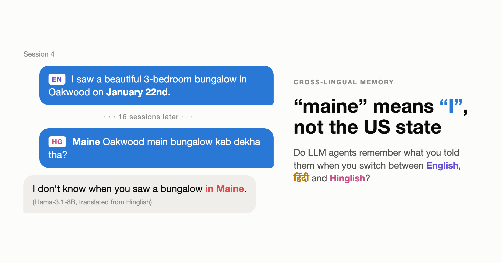
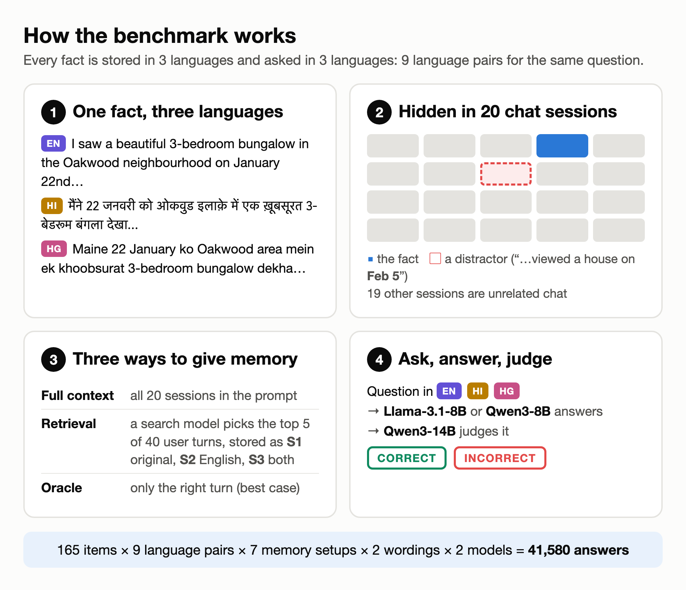
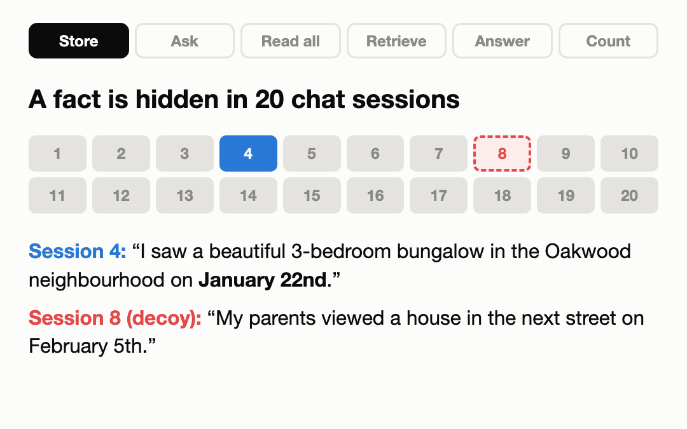
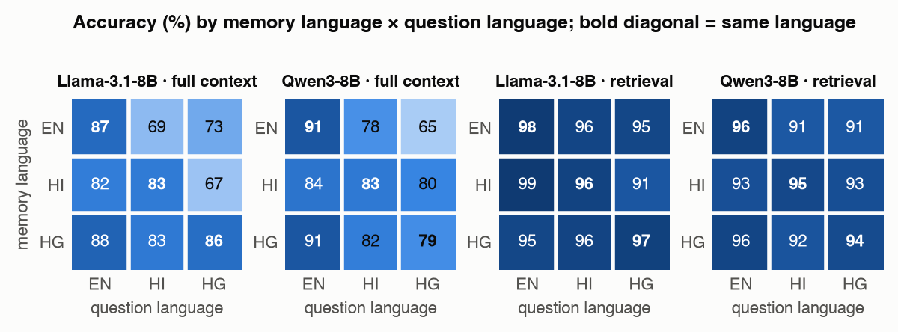
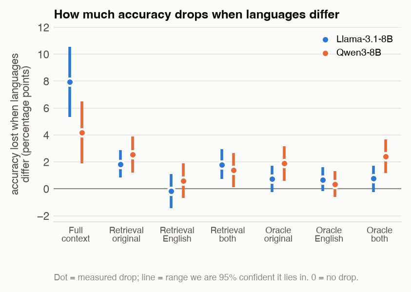
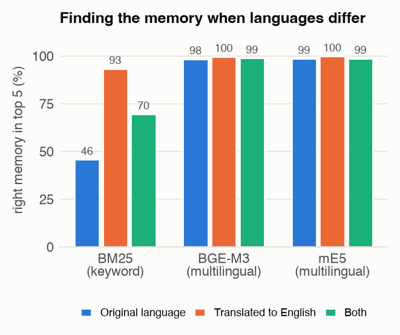
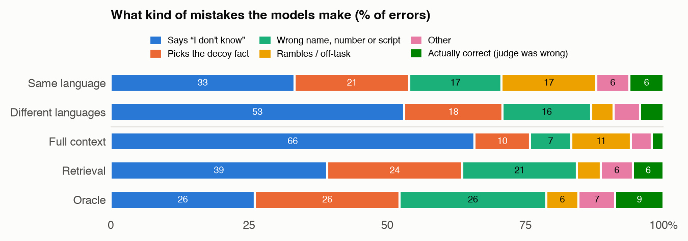
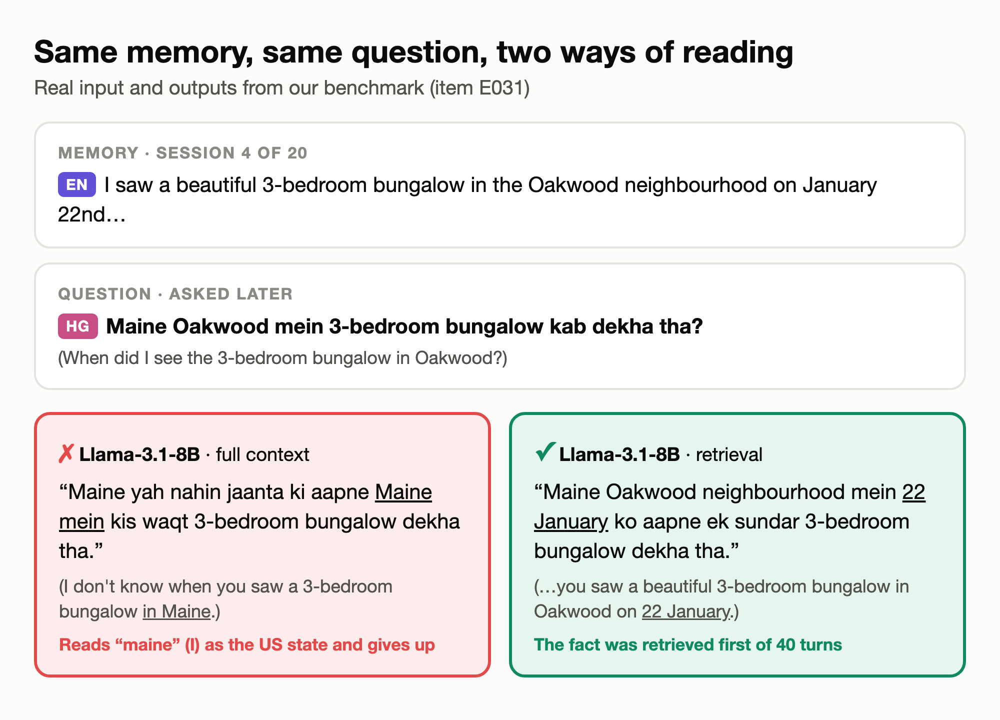

<!--
Draft for the course Substack. Paste section by section into the Substack editor.
Images: report/blog/visuals/ (hero, method, worked_example, pipeline.gif; rebuild with make_visuals.py) and report/figures/fig1-4 *_blog.png (python src/make_figures.py main_r1 --blog). Upload each into Substack where its ![...] line is; the *italic* line under it is the caption. [TODO] marks what the team must fill in.
Code links point to commit 1af1c3a so they keep working after later changes.
-->

# Retrieval Nearly Erases the Cross-Lingual Memory Gap in Small LLM Agents

### Small models forget more when you switch languages, especially when you ask in Hinglish. Fetching the right memory first fixes most of it.

By [TODO Name One](linkedin), [TODO Name Two](linkedin), [TODO Name Three](linkedin), [TODO Faculty Name](link) and [TODO Mentor Name](link)

*A real answer from our benchmark: told a fact in English, asked in Hinglish, Llama-3.1-8B reads “maine” (“I”) as the US state.*

Here is a real exchange from our experiment. Somewhere in twenty earlier chat sessions, a user wrote in English: *"I saw a beautiful 3-bedroom bungalow in the Oakwood neighbourhood on January 22nd."* Later they ask in Hinglish: *"Maine Oakwood mein 3-bedroom bungalow kab dekha tha?"* ("When did I see the bungalow in Oakwood?"). Llama-3.1-8B replies, in Hinglish, that it does not know when you saw a 3-bedroom bungalow *in Maine*. The model has read "maine", the Hindi word for "I", as the US state.

Assistants such as ChatGPT and Claude now keep a **long-term memory**: facts you mentioned in earlier conversations that they bring back later. Benchmarks such as [LongMemEval](https://arxiv.org/abs/2410.10813) and [LoCoMo](https://arxiv.org/abs/2402.17753) measure this, but only in English. Work on [multilingual long contexts](https://arxiv.org/abs/2408.10151) and [code-switched text](https://arxiv.org/abs/2506.14012) shows that models get worse outside English, and that answers buried in the [middle of a long context](https://arxiv.org/abs/2307.03172) are often missed. Nobody has tested the case that real bilingual users create every day: the memory is in one language and the question in another.

Our question is precise. **Input:** a 20-session chat history containing one fact, written in English, Hindi (Devanagari script) or Hinglish (Hindi in Latin script, mixed with English), and a question about that fact in any of the three languages. **Output:** the fact. We measured how much accuracy drops when the two languages differ, which direction is hardest, and whether retrieval or translation fixes it.

We found that the drop is real but mostly a problem of reading long histories, and that when models fail across languages they usually give up rather than make something up.

## How the Benchmark Works

**The key idea is a 3 × 3 grid: every fact is stored in each of three languages and asked about in each of three languages, so the same question can be compared with itself.**

*One fact becomes 9 language pairs × 7 memory setups, so every comparison is the same question asked two ways.*

We started from questions in [LongMemEval](https://arxiv.org/abs/2410.10813) and kept 150 facts that translate naturally into an Indian setting: events with dates, personal facts, and preferences. Each one was translated into Hindi and Hinglish and [checked automatically](https://github.com/samyak-jain-12/cross-lingual-memory/blob/1af1c3abba0a84e0caeee9d70794a402a50fbf15/src/build_items.py#L63-L167) to confirm the key fact survives, does not leak into other turns, and that verbs agree with the user's gender. Many facts come with a **distractor**, a similar but wrong fact placed elsewhere in the history (for the bungalow: "My parents viewed a house in the next street on 5 February"). We also added 15 trick questions whose answer was never mentioned, to catch models that invent answers, for 165 items in all.

Each fact is [hidden among 19 unrelated sessions](https://github.com/samyak-jain-12/cross-lingual-memory/blob/1af1c3abba0a84e0caeee9d70794a402a50fbf15/src/clm/haystack.py#L77-L108), in the same language as the fact. The model then gets the history in one of three ways. In **full context**, the whole history goes into the prompt. In **retrieval**, a multilingual search model [ranks the 40 user turns](https://github.com/samyak-jain-12/cross-lingual-memory/blob/1af1c3abba0a84e0caeee9d70794a402a50fbf15/src/clm/retrieve.py#L83-L96) and only the top 5 are shown. In the **oracle** setup, the model gets the correct turn directly, which tells us how well it can do when finding the memory is not a problem.

Retrieval has one more choice: what language to store memories in. We tried three [storage strategies](https://github.com/samyak-jain-12/cross-lingual-memory/blob/1af1c3abba0a84e0caeee9d70794a402a50fbf15/src/clm/generate.py#L11-L18): keep the original language (S1), translate every memory into English first, an **English pivot** (S2), or store both versions and search both, keeping whichever matches the question better (S3).

*Reading all 20 sessions, Llama loses the fact; retrieval puts it first of 40 turns and the answer turns correct. Each such answer is one data point in the heatmaps below.*

## Experimental Setup

We tested two open models of similar size, **Llama-3.1-8B-Instruct** and **Qwen3-8B**, on every combination: 165 items, 9 language pairs, 7 memory setups and 2 wordings of each question, for **41,580 answers**. For retrieval we used the multilingual dense model [BGE-M3](https://arxiv.org/abs/2402.03216), and compared it with [multilingual E5](https://arxiv.org/abs/2402.05672) and the classic keyword method BM25. Translations into English for the pivot were made by Qwen3-8B.

Answers were marked by a larger model, Qwen3-14B, using a [fixed judging prompt](https://github.com/samyak-jain-12/cross-lingual-memory/blob/1af1c3abba0a84e0caeee9d70794a402a50fbf15/src/clm/prompts.py#L27-L40). To check that the judge can be trusted, we had a model from a different family, Aya Expanse 8B, re-mark 300 answers; the two agreed on **97.6%** of them. Our main measure is accuracy, and every comparison pairs the same item with itself, so differences come from language and not from easier questions. The [full analysis script](https://github.com/samyak-jain-12/cross-lingual-memory/blob/1af1c3abba0a84e0caeee9d70794a402a50fbf15/src/analyze_main.py) reproduces every number below.

## Results

### Retrieval shrinks the cross-lingual penalty, and an English pivot removes it

*Reading the whole history, accuracy drops off the diagonal; with retrieval the whole grid turns dark.*

Look at the two left heatmaps first. Each cell is the accuracy for one memory language (row) and one question language (column); the bold diagonal is where the two match. With the whole history in the prompt, the cells off the diagonal are visibly lighter: Llama gets **85%** of questions right when the languages match and **77%** when they differ, a drop of about **8 percentage points**.

Now look at the right pair. With retrieval, every cell is above 90% and Llama's drop shrinks to **under 2 points**. Store the memories in English first and it disappears: the difference is too small to tell apart from zero. Qwen follows the same pattern with smaller numbers, as the chart below shows.

*Accuracy drops a lot across languages only when the model reads the whole history; with memories translated to English it drops by almost nothing.*

The oracle columns on the right are our best case, where the model is simply handed the right turn. There both models score 94–99% and the drop is at most about 2 points, so once the right memory is in front of the model, language barely matters.

Why does full context suffer so much? Part of the answer is length. Models read text in small chunks called tokens, and Hindi in Devanagari takes about **4 times as many tokens** as the same English text, so a 20-session Hindi history averages 21,600 tokens against 5,200 in English. The model has much more to read, in a script it handles less well, before it reaches the one sentence that matters.

The direction of the question matters too. Questions asked in Hinglish are the hardest. Reading the whole history, Qwen answered **91%** correctly when the memory was in Hinglish and the question in English, but only **65%** when the memory was in English and the question in Hinglish.

### Keyword search breaks across scripts; multilingual search models do not

*Keyword search finds the right memory only 46% of the time across languages, unless memories are translated into English first.*

The chart shows how often the correct memory is among the 5 retrieved turns, for questions whose language differs from the memory's. BM25, which matches exact words, finds it only **46%** of the time with original-language storage, because "bungalow" and "बंगला" share no letters. Translating memories into English lifts it to **93%**. The two multilingual search models already find the right memory **98%** of the time, so for them the storage strategy barely matters, and indeed final accuracy for S1, S2 and S3 is within about one point. The practical lesson is that the English pivot rescues keyword search; with a good multilingual retriever you do not need it.

With retrieval working this well, the remaining errors (2 to 6% of answers) almost all happen after the right memory has been found: the model reads it and still answers wrongly.

### When models fail across languages, they mostly give up

*Half of all errors are the model saying “I don't know” when the answer is in front of it.*

We hand-labelled 150 randomly picked errors and scaled the counts up to match all 2,386 errors. The most common error is not a wrong answer but **false abstention**: the model says it does not know although the fact is in its history. It accounts for **48%** of all errors, **53%** in cross-lingual cells against 33% in matching ones, and **66%** with full context. Next come distractor answers (19%) and corrupted names, numbers or scripts (16%).

*The same model, memory and question: reading the whole history it gives up; reading the 5 retrieved turns it answers correctly.*

The bungalow item from our introduction shows both sides. With the full history, Llama misreads “maine” and gives up; with retrieval, the English memory comes back first of 40 turns, even though the question is in Hinglish, and the same model answers correctly. Other failures were stranger: Llama turned the running-shoe brand Nike into नाइका (Nykaa, an Indian beauty retailer) and UCLA into UC Berkeley.

**The biggest effect in the whole study was not language at all.** When we rephrased questions indirectly ("The estate agent wants to know when I last came to look at that house with the old kitchen"), full-context accuracy fell by **41 to 49 points**, far more than any language mismatch.

## Limitations

The result that surprised us most went against our own prediction. Before running anything, we wrote down that retrieval would suffer *more* than full context when languages differ, because search across languages is hard. The opposite happened: with modern multilingual retrievers, search was the easy part.

We also tried and abandoned one check. We asked Aya to audit all 330 translations, and it passed every one. To test the auditor, we planted 48 deliberately broken translations; it caught only **2**. An LLM that approves everything is not evidence, so we do not use that audit. The translations were checked automatically and read through by the team, but without per-item error labels.

The main limitation is size. Asking the same question in two different English wordings moves accuracy by about 5 points on average and up to 10, which is as large as the language gaps we measure. Our results are for two 8B models, one judge, and 150 facts; the error labels come from a single annotator.

## Conclusion

Three ideas are worth remembering. First, the cross-lingual memory penalty is mostly a long-context problem: retrieving the right memory first shrinks it from about 8 points to under 3. Second, questions in code-mixed Hinglish are the hardest direction, and keyword search fails across scripts unless memories are translated into English. Third, when small models fail across languages, they usually refuse to answer rather than invent one. With more time we would collect native-speaker error labels for the translations and test larger models.

---

## Resources and Credits

- **Code and data:** [github.com/samyak-jain-12/cross-lingual-memory](https://github.com/samyak-jain-12/cross-lingual-memory) (tag `blog-v1`). Every result in this post comes from [`src/analyze_main.py`](https://github.com/samyak-jain-12/cross-lingual-memory/blob/1af1c3abba0a84e0caeee9d70794a402a50fbf15/src/analyze_main.py); the experiment pipeline is in [`src/clm/`](https://github.com/samyak-jain-12/cross-lingual-memory/tree/1af1c3abba0a84e0caeee9d70794a402a50fbf15/src/clm) and the Kaggle notebooks in [`kaggle/`](https://github.com/samyak-jain-12/cross-lingual-memory/tree/1af1c3abba0a84e0caeee9d70794a402a50fbf15/kaggle).
- **Team:** [TODO Name One](linkedin): role; [TODO Name Two](linkedin): role; [TODO Name Three](linkedin): role.
- **Faculty:** [TODO Faculty Name](link). **Mentor:** [TODO Mentor Name](link).
- **Course:** [TODO course name and code], BITS Pilani, 2026.
- **AI use:** Claude (Anthropic) helped draft items and translations, write the code and analysis, label the error sample, make the figures and draft this post. All numbers were checked against the analysis outputs.

**References**

1. Wu et al. [LongMemEval: Benchmarking Chat Assistants on Long-Term Interactive Memory](https://arxiv.org/abs/2410.10813). ICLR 2025.
2. Maharana et al. [Evaluating Very Long-Term Conversational Memory of LLM Agents](https://arxiv.org/abs/2402.17753). ACL 2024.
3. Liu et al. [Lost in the Middle: How Language Models Use Long Contexts](https://arxiv.org/abs/2307.03172). TACL 2024.
4. Hengle et al. [Multilingual Needle in a Haystack](https://arxiv.org/abs/2408.10151). NAACL 2025.
5. Mohamed et al. [Lost in the Mix: Evaluating LLM Understanding of Code-Switched Text](https://arxiv.org/abs/2506.14012). 2025.
6. Chen et al. [M3-Embedding (BGE-M3)](https://arxiv.org/abs/2402.03216). Findings of ACL 2024.
7. Wang et al. [Multilingual E5 Text Embeddings](https://arxiv.org/abs/2402.05672). 2024.
